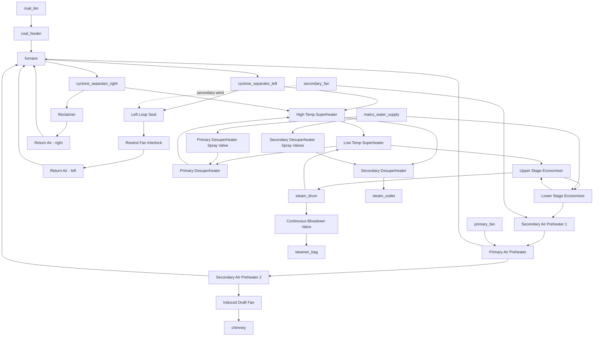

# Boiler Process Knowledge Graph

`boiler_kg.json` — a labeled-property graph of process connectivity, instrumentation,
and control loops for the CFB boiler behind `boiler_historian.duckdb`.

**Sources**
- Fig. 3 (process flow diagram) of Hu, W. et al., *"A long-tailed distribution
  time-series dataset in boiler equipment,"* Scientific Data (2025),
  DOI [10.1038/s41597-025-05096-4](https://doi.org/10.1038/s41597-025-05096-4).
  Full article text is paywalled/bot-blocked — only the figure itself (saved in this
  project as `41597_2025_5096_Fig3_HTML.png`) and the public abstract were accessible,
  not the methods/control narrative.
- `boiler_historian.duckdb`'s `tags` table — tag name → description (originally sourced
  from `columns.csv`, which has since been absorbed into the duckdb and is no longer a
  standalone file in this project).
- Standard CFB boiler engineering practice, used only where the figure and tag
  list don't pin something down (see **Inferred elements** below).

Build script: `scripts/build_kg.py` (canonical, re-runnable — regenerates
`boiler_kg.json` from scratch; rerun it after editing the node/edge definitions).

**Equipment-ID cross-reference:** this KG's equipment node ids are aligned with the
`equipment:` vocabulary used in `RAG docs/` frontmatter wherever a straight rename made
sense (`cyclone_separator_left`/`right`, `steam_outlet`). Three cases remain a genuine
granularity mismatch — the KG models more physical detail than the docs use — and are
resolved via a crosswalk in `mcp_server/equipment_crosswalk.py` rather than a rename:
`economizer` (docs) → `upper_stage_economiser` + `lower_stage_economiser` (KG);
`secondary_air_preheater` (docs) → `secondary_air_preheater_1` + `_2` (KG);
`furnace_chamber` / `furnace_lower_hearth` (docs, two ids) → `furnace` (KG, one node —
`ds_cfb_furnace.md` doesn't assign sensors to a specific zone, so there's no basis to
split this node).

---

## Schema

**Format:** JSON node-link graph (directed, multigraph) — the same shape
`networkx.node_link_graph()` reads directly.

**Node fields:** `id`, `type`, `label`, `provenance` (`pfd` / `columns_csv` / `inferred`),
plus type-specific fields (`units`, `normal_min`, `normal_max`, `instrument_type` for
sensors; `note` for anything non-obvious).

**Sensor `normal_min`/`normal_max`:** these are read live from `boiler_historian.duckdb`'s
`tags` table at KG-build time (not independently maintained), and derived from the real
DCS alarm setpoints in `boiler_alarms.duckdb` wherever one exists -- `range_source_min`/
`range_source_max` on each Sensor node say whether a bound is `dcs_setpoint` (a real,
verified threshold) or `observed_bound_no_alarms` (the tag never alarmed in the 5-day
window, so its full observed range is used as a placeholder). **A `null` bound means
there is no known DCS threshold on that side** (about a third of tags only have a
one-sided setpoint, e.g. `FT_8301` has a `Lo` but no `Hi`) -- it does not mean any value
on that side is acceptable. See `mcp_server/historian_tools.py`'s `historian_list_tags`
docstring for the full derivation logic.

**Node types:**
| Prefix | Meaning |
|---|---|
| `Equipment.*` | Physical equipment (combustion chamber, heat exchangers, fans, separators, vessels, stack, ash/solids handling) |
| `Valve.*` | Control valves, motor-operated valves, check valves |
| `Sensor` | One of the 30 historian tags |
| `ControlLoop` | A closed-loop control relationship |
| `ProcessRelationship` | A looser process relationship, not a classic single PID loop |
| `Boundary.*` | Plant/utility boundary (mains water supply, steam outlet) |

**Edge fields:** `source`, `target`, `relation`, `provenance`, plus relation-specific
fields (`stream` + `hop` for `CONNECTS_TO`; `point` for `HAS_SENSOR`).

**Relation types:**
| Relation | Meaning |
|---|---|
| `CONNECTS_TO` | Physical process connectivity; `stream` names the material/energy stream, `hop` gives order along that stream |
| `HAS_SENSOR` | Equipment/valve → the sensor tag measuring it; `point` gives the specific measurement point |
| `HAS_PV` | Control loop → its process-variable (measured) tag |
| `HAS_MANIPULATED_VARIABLE` | Control loop → the actuator/equipment it drives |
| `HAS_FEEDBACK` | Control loop → a secondary feedback tag |
| `ACTS_ON` | Control loop → the equipment whose output it ultimately regulates |
| `RELATES_TO` | Looser association, used only by the `ProcessRelationship` node |

**Streams** (value of `CONNECTS_TO.stream`): `Coal`, `FlueGas`, `Solids`,
`PrimaryAir`, `SecondaryAir`, `FeedWater`, `Steam`, `DesuperheatingWater`,
`ContinuousBlowdown`.

**Validated:** no orphan nodes, no dangling edge references, no duplicate parallel
`CONNECTS_TO` edges, and the 30 `Sensor` node IDs match `boiler_historian.duckdb`'s
`tags` table exactly (nothing invented, nothing missing).

---

## Process flow (as modeled)

---

## Equipment → sensors

| Equipment | Sensors |
|---|---|
| Furnace (`furnace`) | `PT_8313A`–`PT_8313F` (upper furnace pressure, 6 pts), `TE_8313B` (upper furnace temp), `SXLTCYZ`/`SXLTCYY` (hearth ΔP, L/R) — docs-vocabulary `furnace_chamber`/`furnace_lower_hearth` both resolve here |
| Steam Drum *(inferred)* | `PTCA_8322A` (drum pressure) |
| Cyclone Separator — left (`cyclone_separator_left`) | `ZCLCCY` (ΔP) |
| Cyclone Separator — right (`cyclone_separator_right`) | `YCLCCY` (ΔP) |
| Lower Stage Economiser | `TE_8319A`/`TE_8319B` (flue gas outlet temp, L/R) |
| Upper Stage Economiser (inlet duct) | `AIR_8301A`/`AIR_8301B` (flue gas O2, L/R) |
| Primary Air Preheater | `TE_8303` (air outlet temp) |
| Secondary Air Preheater (stage 2) | `TE_8304` (air outlet temp) |
| Primary Fan | `FT_8301` (outlet flow) |
| Secondary Fan | `FT_8302` (outlet flow) |
| Return Air Injection — left | `FT_8306A` |
| Return Air Injection — right | `FT_8306B` |
| Induced Draft Fan | `YFJ3_AI` (motor current), `YFJ3_ZD1`/`YFJ3_ZD2` (bearing vibration) |
| Primary Desuperheater | `YJJWSLL` (spray water flow) |
| Primary Desuperheater Spray Valve | `TV_8329ZC` (valve position) |
| Steam Outlet (`steam_outlet`) | `TE_8332A` (**primary KPI**), `PTCA_8324` (pressure), `ZZQBCHLL` (compensated flow) |

All 30 historian tags are placed exactly once. No tag describes the secondary
desuperheater spray flow, furnace draft-controller output, or combustion-air
damper position — those exist physically (per the PFD / general CFB design) but
aren't instrumented in this 30-tag historian, so don't invent tag names for them.

---

## Control loops

### 1. Primary steam-temperature attemperation — **explicit**
`TV_8329ZC` is literally named *"Primary desuperheater outlet steam temperature
regulating valve"* in the historian's `tags` table — a real control valve, not inferred.
- **PV:** `TE_8332A` (boiler outlet steam temp)
- **Manipulated variable:** `TV_8329ZC` → spray water into the Primary Desuperheater
- **Feedback:** `YJJWSLL` (spray water flow)
- **Acts on:** Primary Desuperheater

### 2. Furnace draft / negative-pressure balance — *inferred, standard practice*
Induced-draft fan draw is balanced against primary + secondary fan input to hold the
furnace slightly negative. The dataset instruments the PV side only — no
draft-controller output tag exists among the 30 tags.
- **PV:** `PT_8313A`–`PT_8313F`
- **Manipulated:** Induced Draft Fan, Primary Fan, Secondary Fan

### 3. Combustion excess-air (O2 trim) — *inferred, standard practice*
- **PV:** `AIR_8301A`, `AIR_8301B`
- **Manipulated:** Primary Fan, Secondary Fan air flow
- **Feedback:** `FT_8301`, `FT_8302`

### 4. Bed inventory / solids recirculation — *inferred, process relationship*
Loop-seal aeration ("secondary wind") governs how fast solids recirculate back to the
furnace; cyclone ΔP reflects capture efficiency, hearth ΔP reflects bed density. Not
modeled as a single PID loop — related tags only.
- **Related:** `FT_8306A`, `FT_8306B`, `SXLTCYZ`, `SXLTCYY`, `ZCLCCY`, `YCLCCY`, left loop seal, right reclaimer

---

## Inferred elements — flag for validation against the real P&ID

These aren't drawn explicitly in Fig. 3 / stated in the accessible abstract; they're
filled in from standard CFB design so the graph has no gaps. Each is tagged
`provenance: "inferred"` in the JSON so they're easy to find and correct:

1. **Steam drum** — not drawn as a distinct vessel in Fig. 3, but required by
   `PTCA_8322A` ("steam drum pressure") and by the saturated-steam feed into the low
   temp superheater.
2. **Right-side solids-return leg** (`ash_reclaimer_right` → `return_air_injection_right`)
   — mirrored from the explicitly-drawn left leg to match the `FT_8306B` tag.
3. **"Secondary wind" source for the loop seal** — connected to the secondary fan
   because Fig. 3's own label says "secondary wind," though the exact duct routing
   isn't drawn.
4. **Economiser-outlet destination** — Fig. 3 labels the return path only as "to mains
   water supply"; routed here to the steam drum as the standard destination for this
   boiler type.
5. **Furnace draft and O2-trim control loops** (#2 and #3 above) — physically certain
   to exist in some form, but their actuators/output tags aren't in the 30-tag
   historian, so they're marked inferred rather than evidenced by a named tag.

If you have the actual P&ID or the paper's methods section, these five points are
exactly what to check first.
